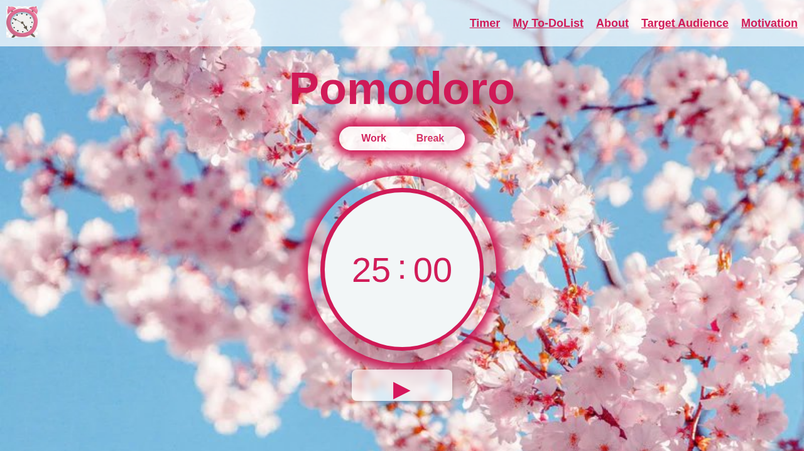

# 🍅 Pomodoro Timer

Application web de gestion du temps basée sur la **technique Pomodoro**, avec minuteur, alarme sonore et liste de tâches. Développée en HTML, CSS et JavaScript pur (sans framework).




## Fonctionnalités
- ⏱️ Minuteur de **25 min** de travail, pause courte de **5 min**, pause longue de **15 min** toutes les 4 sessions
- ▶️ Démarrer, mettre en pause et réinitialiser le minuteur
- 🔔 Alarme sonore en boucle à la fin d'une session, avec un bouton pour l'arrêter et lancer la pause
- 💬 Notification navigateur à la fin du temps de travail
- ✅ Liste de tâches : ajout et suppression
- 📄 Sections explicatives : la technique Pomodoro, à qui elle s'adresse, motivation

## Technologies
- HTML5
- CSS3 (variables CSS, flexbox, grid)
- JavaScript (ES6, manipulation du DOM, `setInterval`, API Notification, objet `Audio`)
- [Font Awesome](https://fontawesome.com/) pour les icônes et Google Fonts (Open Sans)

## Structure du projet
```
pomodoro-timer/
├── index.html
├── css/
│   └── style.css
├── js/
│   └── script.js
├── assets/
│   ├── images/
│   └── audio/
│       └── morning-alarm.mp3
└── docs/
    └── screenshot.png
```

## Lancer le projet
Aucune installation nécessaire :
```bash
git clone https://github.com/<votre-pseudo>/pomodoro-timer.git
cd pomodoro-timer
```
Puis ouvrez `index.html` dans votre navigateur (ou utilisez l'extension *Live Server* de VS Code).

> Une connexion internet est requise pour charger les icônes (Font Awesome) et la police (Google Fonts).

## Publier en ligne avec GitHub Pages
1. Sur GitHub : **Settings → Pages**
2. *Source* : `Deploy from a branch`, branche `main`, dossier `/ (root)`
3. Après une minute, le site est disponible sur `https://<votre-pseudo>.github.io/pomodoro-timer/`

## Pistes d'amélioration
- Rendre l'interface responsive (mobile)
- Sauvegarder les tâches avec `localStorage`
- Durées de travail et de pause personnalisables
- Compteur de sessions terminées

## Auteur
**Hiba GOURRI**
